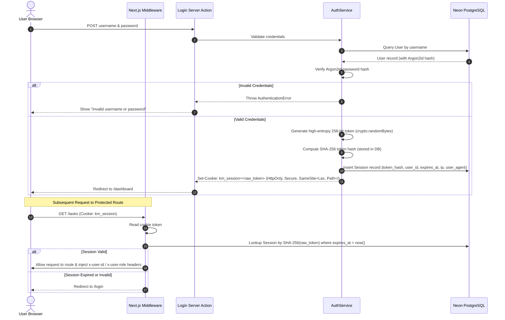
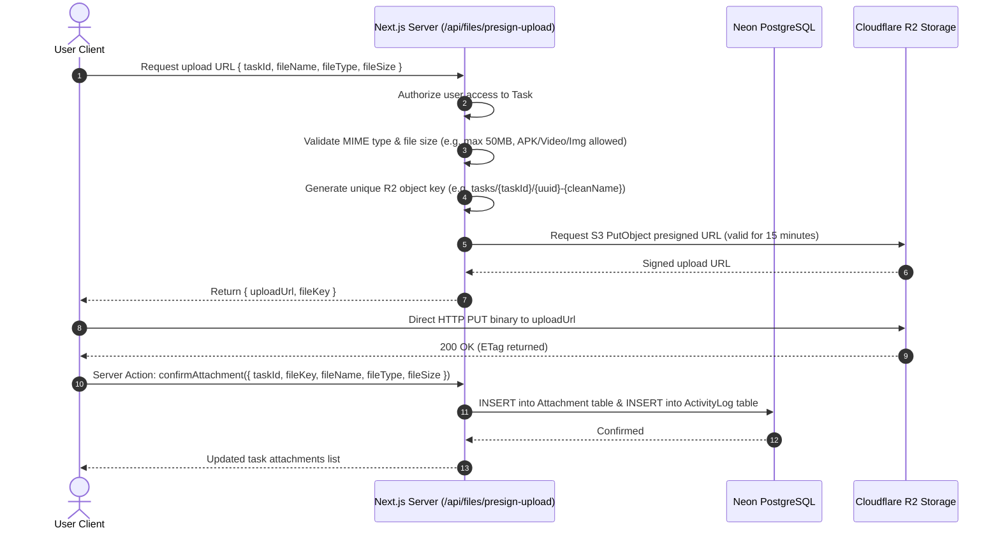

# System Architecture & Technical Specifications

## 1. Overview & Architectural Principles

The application is a private, internal team management and task tracking system designed for a single organization/workspace. It replaces external, heavyweight project management tools (like JIRA) with a streamlined, fast, and bespoke platform tailored to three distinct roles: **Manager**, **Scrum Master**, and **Developer**.

### Core Architecture Tenets
1. **Single Full-Stack Framework**: Next.js (App Router) serves both user interface and backend logic. There is **no separate backend application** (no FastAPI, Express, Spring Boot, or external microservices).
2. **Layered Backend Isolation**: Page components never invoke database calls or perform raw business logic directly. The architecture strictly enforces a clean boundary:
   - **Presentation Layer**: Server Components (RSC) for data fetching and layout; Client Components (`'use client'`) strictly for interactivity (forms, drag-and-drop, modals, dialogs).
   - **Action & API Layer**: Next.js Server Actions for state mutations (form submissions, status changes) and Route Handlers for file upload/download endpoints and webhook-style integrations.
   - **Service / Business Logic Layer**: Pure TypeScript domain services encapsulated under `src/services/*` or `lib/services/*`. All authorization checks, validation, database transactions, and audit logging happen here.
   - **Data Access Layer**: Prisma Client singleton under `lib/prisma.ts` querying hosted PostgreSQL (Neon).
3. **Zero Third-Party Auth Dependencies**: No Clerk, Auth0, Firebase, or Supabase Auth. The application implements standard, high-security custom credentials authentication using **Argon2id** password hashing, database-backed sessions with cryptographic session tokens, and secure `HttpOnly` cookies.
4. **Secure File Storage with Object Storage**: Cloudflare R2 object storage handles all raw binaries (images, videos, APK builds, logs). PostgreSQL stores only metadata and file references. No public buckets; all access is mediated through short-lived presigned URLs.
5. **Strict Audit Trail and Immutability**: All status transitions, task assignments, request submissions, and administrative overrides create immutable records in database transaction blocks alongside the primary mutation.

---

## 2. System Architecture Diagram

```mermaid
flowchart TD
    subgraph Client ["Client Browser"]
        UI["UI Layer (Next.js App Router + Tailwind v4 + shadcn/ui)"]
        DnD["dnd-kit (Board Drag-and-Drop)"]
        RChart["Recharts (Analytics Dashboards)"]
    end

    subgraph NextServer ["Next.js Server (Node.js Runtime on Vercel)"]
        Middleware["Next.js Middleware (Session & Route Guard)"]
        
        subgraph Endpoints ["Entrypoints"]
            RSC["React Server Components (SSR / Data Fetching)"]
            Actions["Server Actions ('use server') (Mutations)"]
            Routes["Route Handlers (/api/*) (Upload/Download, Health)"]
        end

        subgraph ServiceLayer ["Domain Service Layer (lib/services/*)"]
            AuthService["Auth & Session Service"]
            TaskService["Task & Board Service"]
            StatusService["Status Transition & History Service"]
            RequestService["Request & Leave Service"]
            ActivityService["Audit & Activity Logging Service"]
            StorageService["Cloudflare R2 Storage Service"]
            UserService["User Management Service"]
        end

        subgraph SecurityLayer ["Security & Validation"]
            RBAC["RBAC Engine (lib/auth/permissions.ts)"]
            ZodSchemas["Validation Layer (lib/validations/*)"]
            ArgonHasher["Argon2id Hasher"]
        end
    end

    subgraph DataStorage ["External Managed Infrastructure"]
        NeonDB[("Neon Serverless PostgreSQL\n(Prisma ORM)")]
        R2Storage[("Cloudflare R2 Object Storage\n(S3-Compatible Private Bucket)")]
    end

    Client -->|HTTPS + HttpOnly Cookie| Middleware
    Middleware --> Endpoints
    Endpoints --> SecurityLayer
    Endpoints --> ServiceLayer
    ServiceLayer -->|Prisma Client| NeonDB
    ServiceLayer -->|AWS S3 SDK (v3)| R2Storage
    R2Storage -.->|Presigned Upload/Download URL| Client
```

---

## 3. Technology Stack & Component Specifications

| Layer | Technology | Version / Specification | Rationale & Usage |
|---|---|---|---|
| **Framework** | Next.js (App Router) | `16.4.x` (React 19.3.x) | Native server actions, React Server Components, streaming, partial pre-rendering. |
| **Language** | TypeScript | `^5.x` | Strict type checking (`strict: true`), shared schemas between server and client. |
| **Styling** | Tailwind CSS | `v4.3.x` | Integrated via `@tailwindcss/turbopack`. Clean utility styling conforming to the Dub design system tokens. |
| **Component Library** | shadcn/ui + Radix UI | Latest compatible with React 19 / TW v4 | Accessible primitives (dialogs, dropdowns, popovers, tabs, command palettes). |
| **Drag & Drop** | `@dnd-kit/core`, `@dnd-kit/sortable` | Modern standard | Keyboard and touch-accessible drag and drop for task boards. |
| **Visualization** | Recharts | Modern React 19 compatible | Dashboard analytics, burn-up/down, task distribution, workload charts. |
| **Database** | PostgreSQL | Hosted on Neon | Relational integrity, foreign key cascades, JSONB capabilities, fast connection pooling via Neon Serverless driver. |
| **ORM** | Prisma ORM | `^6.x` | Type-safe query builder, automated migration management (`prisma migrate`). |
| **Hashing** | `argon2` or `@node-rs/argon2` | Argon2id variant | Industry standard memory-hard password hashing resistant to GPU/ASIC cracking. |
| **File Storage** | Cloudflare R2 | S3-compatible API via `@aws-sdk/client-s3` & `@aws-sdk/s3-request-presigner` | Zero egress fee object storage for images, videos, logs, and Android APK builds. |
| **Deployment** | Vercel | Production Edge/Serverless platform | Native zero-configuration Next.js hosting. |

---

## 4. Directory & Code Organization Structure

To prevent spaghetti code and maintain clear boundaries suitable for AI agent execution, the code follows this modular folder architecture:

```
km-scrum/
├── app/
│   ├── (auth)/
│   │   ├── login/
│   │   │   └── page.tsx                 # Login view
│   │   ├── change-password/
│   │   │   └── page.tsx                 # Forced initial password change
│   │   └── layout.tsx                   # Centered minimal auth layout
│   ├── (dashboard)/
│   │   ├── layout.tsx                   # Authenticated app shell (Sidebar, TopNav, Session Provider)
│   │   ├── page.tsx                     # Dynamic role-based redirect (/dashboard)
│   │   ├── developer/
│   │   │   ├── page.tsx                 # Developer personal dashboard
│   │   │   └── history/page.tsx         # Developer personal completed task history
│   │   ├── scrum-master/
│   │   │   ├── page.tsx                 # Scrum Master workload & team dashboard
│   │   │   └── team-status/page.tsx     # Live status by developer
│   │   ├── manager/
│   │   │   ├── page.tsx                 # Manager executive dashboard & KPIs
│   │   │   └── users/page.tsx           # User management (Manager-only)
│   │   ├── tasks/
│   │   │   ├── page.tsx                 # Task board / list view
│   │   │   ├── [id]/page.tsx            # Task detail view with history & attachments
│   │   │   └── new/page.tsx             # Task creation page or modal route
│   │   ├── planning/
│   │   │   ├── daily/page.tsx           # Day-wise developer breakdown
│   │   │   └── monthly/page.tsx         # Monthly calendar & schedule distribution
│   │   ├── requests/
│   │   │   ├── page.tsx                 # Requests listing (filtered by role)
│   │   │   ├── leaves/page.tsx          # Leave applications & approval queue
│   │   │   ├── complaints/page.tsx      # Complaints queue (strict privacy)
│   │   │   └── tickets/page.tsx         # General tickets / issues
│   │   └── activity-logs/
│   │       └── page.tsx                 # Immutable audit log with comprehensive filters
│   ├── api/
│   │   ├── auth/
│   │   │   ├── login/route.ts           # Optional API route handler for login
│   │   │   └── logout/route.ts          # Session invalidation & cookie clear
│   │   ├── files/
│   │   │   ├── presign-upload/route.ts  # Generates signed PUT URLs for R2
│   │   │   └── download/[id]/route.ts   # Authorized redirect to signed GET URL
│   │   └── health/route.ts              # System health & DB check
│   ├── globals.css                      # Tailwind v4 import & Dub design tokens
│   └── layout.tsx                       # Root layout with fonts & metadata
├── components/
│   ├── ui/                              # shadcn / Radix primitives (Button, Dialog, Input, etc.)
│   ├── layout/                          # AppSidebar, Header, Breadcrumbs, UserDropdown
│   ├── auth/                            # LoginForm, ChangePasswordForm
│   ├── tasks/                           # TaskCard, TaskBoard, StatusChangeModal, TaskDetail
│   ├── planning/                        # DailyCalendarPicker, DeveloperWorkloadGrid, MonthView
│   ├── requests/                        # LeaveRequestModal, ComplaintModal, RequestDetailModal
│   ├── activity/                        # ActivityFilterBar, ActivityTable, ActivityDiffView
│   ├── files/                           # AttachmentUploader, FilePreview, ApkDownloadCard
│   └── dashboard/                       # MetricCard, WorkloadChart, StatusBreakdown
├── lib/
│   ├── prisma.ts                        # Prisma singleton instance
│   ├── auth/
│   │   ├── session.ts                   # Session creation, validation, cookie management
│   │   ├── password.ts                  # Argon2id hash & verify functions
│   │   └── permissions.ts              # Strict RBAC permission matrix & assertion helpers
│   ├── r2.ts                            # Cloudflare R2 S3 client initialization
│   ├── utils.ts                         # Tailwind cn helper, date formatting, formatters
│   └── validations/                     # Zod schemas for forms and server actions
│       ├── auth.ts
│       ├── task.ts
│       ├── request.ts
│       └── user.ts
├── services/                            # Core domain logic (called by Server Actions)
│   ├── auth.service.ts
│   ├── task.service.ts
│   ├── status.service.ts
│   ├── request.service.ts
│   ├── activity.service.ts
│   ├── storage.service.ts
│   └── user.service.ts
├── prisma/
│   ├── schema.prisma                    # Relational database models & indexes
│   ├── seed.ts                          # Initial manager seed script
│   └── migrations/                      # Automated Prisma migration files
├── docs/                                # Technical specification & planning documents
├── middleware.ts                        # Edge middleware for session verification & route guarding
├── package.json
├── tsconfig.json
└── next.config.ts
```

---

## 5. Security & Authentication Architecture

### 5.1 Custom Database-Backed Session Flow


### 5.2 Security Guarantees
1. **Password Protection**: Stored with **Argon2id** (memory cost: 64MB, time iterations: 3, parallelism: 4). Plaintext passwords are never logged, echoed, or stored.
2. **Session Security**: Raw tokens sent to client cookies are 32-byte cryptographic random strings. Only the **SHA-256 hash** of the token is saved in the database. A database leak cannot be used to forge active sessions.
3. **Session Invalidation**:
   - Explicit user logout immediately removes the session row.
   - Password reset immediately invalidates **all** active sessions for that user.
   - Session duration is 7 days with sliding expiration or fixed rolling window.
4. **Temporary Passwords & Forced Reset**: Accounts created by the Manager are flagged with `must_change_password = true`. Any user authenticated with this flag set is restricted by middleware to `/change-password` until updated.
5. **Role-Based Server Guards**: Every Server Action begins with an explicit RBAC assertion:
   ```typescript
   const session = await requireAuth();
   assertPermission(session.user.role, 'TASK_REASSIGN');
   ```

---

## 6. File Storage & Cloudflare R2 Upload Flow

Direct binary transfers through Next.js serverless functions degrade performance and risk payload size limits (Vercel has a 4.5MB Server Action payload limit). Therefore, file uploads use **Presigned S3/R2 URLs**:



### File Access Authorization
- Direct public bucket access is disabled.
- To download or preview an attachment, the client queries `/api/files/download/[id]`.
- The Route Handler checks whether the current session has permission to view the associated task.
- If authorized, it generates a presigned S3 `GetObject` URL valid for **5 minutes** and issues a `307 Temporary Redirect` to the signed R2 URL.

---

## 7. Audit Logging & State Consistency Architecture

Every mutation that affects system state (task creation, status change, priority update, assignment, request submission, leave approval) is executed within a **Prisma Interactive Transaction** (`prisma.$transaction`).

This guarantees:
1. The primary entity update and the `ActivityLog` entry are atomic. If the activity log insertion fails, the task mutation rolls back completely.
2. For task status transitions, three writes occur atomically:
   - Update `Task.status` and `Task.updated_at`.
   - Insert new row into `TaskStatusHistory` (storing previous status, new status, changed_by, reason).
   - Insert new row into `ActivityLog` (storing activity type `TASK_STATUS_CHANGED`, metadata diff).

---

## 8. Design System Implementation (Dub Reference)

The visual design implements the **Dub Style Reference** (`c:\Users\Support Team\Downloads\DESIGN.md`):
- **Aesthetic**: Minimalist, flat, border-first elevation ("frosted link dashboard on rice paper").
- **Canvas & Surface**: Pure white canvas (`#ffffff`), subtle paper mist (`#f5f5f5`) for secondary containers.
- **Hairline Borders**: 1px `#e5e5e5` (Ash) defines all card surfaces and inputs, eliminating heavy drop shadows.
- **Primary Brand Color**: Electric Blue (`#2563eb`) for active accents, key metrics, and links.
- **Action Buttons**: Deep Sapphire (`#1e40af`) or Midnight Ink (`#0a0a0a`) for primary CTA; Outlined Ash button (`#ffffff` + 1px `#e5e5e5`) for secondary actions.
- **Pill Architecture**: Full rounded pill badges (`rounded-full` / `9999px`) for task statuses, priority indicators, and tags.
- **Typography Scale**: Satoshi 500 for display titles (or Inter 500 medium fallback), Inter for all body and table elements, Geist Mono for task IDs and code tokens.
