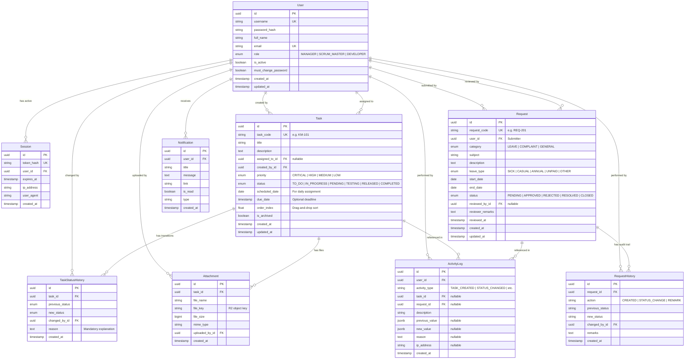

# Database Design & Schema Specification

## 1. Database Architecture & Engine Overview

The data persistence layer is powered by **PostgreSQL** (hosted on **Neon**) and managed through **Prisma ORM**.

### Architectural Tenets
1. **Relational Integrity**: Strict foreign key constraints with appropriate cascade rules (or `RESTRICT` to prevent accidental loss of audit history).
2. **Immutable Audit Trails**: `TaskStatusHistory`, `RequestHistory`, and `ActivityLog` tables are strictly append-only. No `UPDATE` or `DELETE` operations are ever executed against them.
3. **Soft-Deletion**: `Task` records utilize an `is_archived` boolean flag rather than hard deletes. Hard deletes orphan historical status logs and break audit integrity.
4. **Fractional Indexing for Drag-and-Drop**: Tasks store a floating-point `order_index` to support effortless reordering and column drops without updating every row in a status column.
5. **High-Performance Filtering**: Strategic compound indexes are established to support fast queries on daily developer workloads, monthly calendars, and activity log filters.

---

## 2. Entity-Relationship (ER) Diagram



---

## 3. Detailed Data Dictionary & Schema Specifications

### 3.1 `User`
Stores all system actors with secure credentials and access levels.

| Column | Type | Constraints | Description |
|---|---|---|---|
| `id` | `UUID` | Primary Key, `default(gen_random_uuid())` | Unique internal user ID |
| `username` | `VARCHAR(50)` | Unique, Not Null | Unique login handle (case-insensitive indexing) |
| `password_hash` | `VARCHAR(255)` | Not Null | Argon2id password hash string |
| `full_name` | `VARCHAR(100)` | Not Null | Display name for dashboards & assignments |
| `email` | `VARCHAR(255)` | Unique, Nullable | Optional contact email |
| `role` | `UserRole` Enum | Not Null, Default: `DEVELOPER` | Enum: `MANAGER`, `SCRUM_MASTER`, `DEVELOPER` |
| `is_active` | `BOOLEAN` | Not Null, Default: `true` | Allows deactivating users without deleting records |
| `must_change_password`| `BOOLEAN` | Not Null, Default: `false` | Forces password change upon first login |
| `created_at` | `TIMESTAMPTZ` | Not Null, Default: `now()` | Account creation timestamp |
| `updated_at` | `TIMESTAMPTZ` | Not Null, Auto-update | Last profile update |

**Indexes**:
- `users_username_key` (UNIQUE)
- `users_email_key` (UNIQUE, Partial where email is not null)
- `users_role_idx` on `(role)`
- `users_is_active_idx` on `(is_active)`

---

### 3.2 `Session`
Database-backed session storage for custom stateful session management.

| Column | Type | Constraints | Description |
|---|---|---|---|
| `id` | `UUID` | Primary Key, `default(gen_random_uuid())` | Session record identifier |
| `token_hash` | `VARCHAR(64)` | Unique, Not Null | SHA-256 hash of the client cookie token |
| `user_id` | `UUID` | Foreign Key -> `User(id)` ON DELETE CASCADE | Authenticated user |
| `expires_at` | `TIMESTAMPTZ` | Not Null | Expiration timestamp (e.g. 7 days from issue) |
| `ip_address` | `VARCHAR(45)` | Nullable | Client IP for audit & session inspection |
| `user_agent` | `TEXT` | Nullable | Browser User-Agent header |
| `created_at` | `TIMESTAMPTZ` | Not Null, Default: `now()` | Session creation time |

**Indexes**:
- `sessions_token_hash_key` (UNIQUE)
- `sessions_user_id_idx` on `(user_id)`
- `sessions_expires_at_idx` on `(expires_at)` (for cleanup routines)

---

### 3.3 `Task`
Core entity for work management.

| Column | Type | Constraints | Description |
|---|---|---|---|
| `id` | `UUID` | Primary Key, `default(gen_random_uuid())` | Unique internal task ID |
| `task_code` | `VARCHAR(20)` | Unique, Not Null | Human-readable sequential key, e.g. `KM-101` |
| `title` | `VARCHAR(255)` | Not Null | Task headline |
| `description` | `TEXT` | Not Null | Detailed specifications & instructions |
| `assigned_to_id` | `UUID` | Foreign Key -> `User(id)` ON DELETE SET NULL, Nullable | Assigned developer |
| `created_by_id` | `UUID` | Foreign Key -> `User(id)` ON DELETE RESTRICT | Creator (Manager or Scrum Master) |
| `priority` | `TaskPriority` Enum | Not Null, Default: `MEDIUM` | Enum: `CRITICAL`, `HIGH`, `MEDIUM`, `LOW` |
| `status` | `TaskStatus` Enum | Not Null, Default: `TO_DO` | Enum: `TO_DO`, `IN_PROGRESS`, `PENDING`, `TESTING`, `RELEASED`, `COMPLETED` |
| `scheduled_date` | `DATE` | Not Null | Scheduled calendar day for daily work assignment |
| `due_date` | `TIMESTAMPTZ` | Nullable | Optional final completion deadline |
| `order_index` | `DOUBLE PRECISION` | Not Null, Default: `1000.0` | Ordering index within status column for DnD |
| `is_archived` | `BOOLEAN` | Not Null, Default: `false` | Soft-deletion flag |
| `created_at` | `TIMESTAMPTZ` | Not Null, Default: `now()` | Creation timestamp |
| `updated_at` | `TIMESTAMPTZ` | Not Null, Auto-update | Last modification timestamp |

**Indexes**:
- `tasks_task_code_key` (UNIQUE)
- `tasks_assigned_date_idx` on `(assigned_to_id, scheduled_date)` (for Developer daily view)
- `tasks_date_status_idx` on `(scheduled_date, status)` (for Manager & SM daily/monthly views)
- `tasks_status_order_idx` on `(status, order_index)` (for Board ordering)
- `tasks_is_archived_idx` on `(is_archived)`

---

### 3.4 `TaskStatusHistory`
Mandatory immutable audit record for every status change.

| Column | Type | Constraints | Description |
|---|---|---|---|
| `id` | `UUID` | Primary Key, `default(gen_random_uuid())` | History record ID |
| `task_id` | `UUID` | Foreign Key -> `Task(id)` ON DELETE CASCADE | Associated task |
| `previous_status` | `TaskStatus` Enum | Not Null | Status prior to transition |
| `new_status` | `TaskStatus` Enum | Not Null | Transitioned status |
| `changed_by_id` | `UUID` | Foreign Key -> `User(id)` ON DELETE RESTRICT | User performing transition |
| `reason` | `TEXT` | Not Null | Mandatory explanation / rationale |
| `created_at` | `TIMESTAMPTZ` | Not Null, Default: `now()` | Timestamp of status change |

**Indexes**:
- `task_status_history_task_idx` on `(task_id, created_at DESC)`
- `task_status_history_changed_by_idx` on `(changed_by_id)`

---

### 3.5 `Attachment`
Metadata references for files stored in Cloudflare R2.

| Column | Type | Constraints | Description |
|---|---|---|---|
| `id` | `UUID` | Primary Key, `default(gen_random_uuid())` | Attachment record ID |
| `task_id` | `UUID` | Foreign Key -> `Task(id)` ON DELETE CASCADE | Attached task |
| `file_name` | `VARCHAR(255)` | Not Null | Original sanitized filename |
| `file_key` | `VARCHAR(500)` | Unique, Not Null | Unique Cloudflare R2 object path |
| `file_size` | `BIGINT` | Not Null | File size in bytes |
| `mime_type` | `VARCHAR(100)` | Not Null | Verified MIME type (image, video, apk, etc.) |
| `uploaded_by_id`| `UUID` | Foreign Key -> `User(id)` ON DELETE RESTRICT | Uploader user ID |
| `created_at` | `TIMESTAMPTZ` | Not Null, Default: `now()` | Upload confirmation timestamp |

**Indexes**:
- `attachments_task_id_idx` on `(task_id)`
- `attachments_file_key_key` (UNIQUE)

---

### 3.6 `Request`
Tickets raised by Developers (Leave applications, Complaints, General issues).

| Column | Type | Constraints | Description |
|---|---|---|---|
| `id` | `UUID` | Primary Key, `default(gen_random_uuid())` | Request record ID |
| `request_code` | `VARCHAR(20)` | Unique, Not Null | Formatted ID, e.g. `REQ-101` |
| `user_id` | `UUID` | Foreign Key -> `User(id)` ON DELETE RESTRICT | Submitter (Developer) |
| `category` | `RequestCategory` Enum | Not Null | Enum: `LEAVE`, `COMPLAINT`, `GENERAL` |
| `subject` | `VARCHAR(255)` | Not Null | Summary or subject of the request |
| `description` | `TEXT` | Not Null | Detailed description or reason |
| `leave_type` | `LeaveType` Enum | Nullable | Required if category is `LEAVE` |
| `start_date` | `DATE` | Nullable | Leave start date |
| `end_date` | `DATE` | Nullable | Leave end date |
| `status` | `RequestStatus` Enum | Not Null, Default: `PENDING` | Enum: `PENDING`, `APPROVED`, `REJECTED`, `RESOLVED`, `CLOSED` |
| `reviewed_by_id`| `UUID` | Foreign Key -> `User(id)` ON DELETE SET NULL, Nullable | Reviewer (Scrum Master or Manager) |
| `reviewer_remarks`| `TEXT` | Nullable | Feedback, approval conditions, or resolution note |
| `reviewed_at` | `TIMESTAMPTZ` | Nullable | Timestamp of review action |
| `created_at` | `TIMESTAMPTZ` | Not Null, Default: `now()` | Submission timestamp |
| `updated_at` | `TIMESTAMPTZ` | Not Null, Auto-update | Last status or review change |

**Indexes**:
- `requests_request_code_key` (UNIQUE)
- `requests_user_category_idx` on `(user_id, category)`
- `requests_category_status_idx` on `(category, status)`
- `requests_leave_dates_idx` on `(category, status, start_date, end_date)` (for calendar leave badges)

---

### 3.7 `RequestHistory`
Audit trail of reviews, status changes, and remarks on requests.

| Column | Type | Constraints | Description |
|---|---|---|---|
| `id` | `UUID` | Primary Key, `default(gen_random_uuid())` | Audit record ID |
| `request_id` | `UUID` | Foreign Key -> `Request(id)` ON DELETE CASCADE | Associated request |
| `action` | `VARCHAR(50)` | Not Null | e.g. `CREATED`, `APPROVED`, `REJECTED`, `REMARKED` |
| `previous_status`| `VARCHAR(50)` | Nullable | Status prior to change |
| `new_status` | `VARCHAR(50)` | Nullable | New status |
| `changed_by_id` | `UUID` | Foreign Key -> `User(id)` ON DELETE RESTRICT | Actor |
| `remarks` | `TEXT` | Nullable | Remarks captured during action |
| `created_at` | `TIMESTAMPTZ` | Not Null, Default: `now()` | Timestamp |

**Indexes**:
- `request_history_request_idx` on `(request_id, created_at DESC)`

---

### 3.8 `ActivityLog`
Immutable centralized log of system events.

| Column | Type | Constraints | Description |
|---|---|---|---|
| `id` | `UUID` | Primary Key, `default(gen_random_uuid())` | Log record ID |
| `user_id` | `UUID` | Foreign Key -> `User(id)` ON DELETE RESTRICT | Actor |
| `activity_type` | `VARCHAR(50)` | Not Null | e.g. `TASK_STATUS_CHANGED`, `TASK_CREATED`, `USER_LOGIN` |
| `task_id` | `UUID` | Foreign Key -> `Task(id)` ON DELETE SET NULL, Nullable | Associated task |
| `request_id` | `UUID` | Foreign Key -> `Request(id)` ON DELETE SET NULL, Nullable | Associated request |
| `description` | `TEXT` | Not Null | Human-readable log entry |
| `previous_value`| `JSONB` | Nullable | Snapshot of values before modification |
| `new_value` | `JSONB` | Nullable | Snapshot of values after modification |
| `reason` | `TEXT` | Nullable | Mandatory reason (for status changes) or optional note |
| `ip_address` | `VARCHAR(45)` | Nullable | Origin IP |
| `created_at` | `TIMESTAMPTZ` | Not Null, Default: `now()` | Event occurrence timestamp |

**Indexes**:
- `activity_logs_created_at_idx` on `(created_at DESC)`
- `activity_logs_user_date_idx` on `(user_id, created_at DESC)`
- `activity_logs_type_date_idx` on `(activity_type, created_at DESC)`
- `activity_logs_task_idx` on `(task_id)`
- `activity_logs_request_idx` on `(request_id)`

---

### 3.9 `Notification`
In-app notifications for task assignments, status changes, and request resolutions.

| Column | Type | Constraints | Description |
|---|---|---|---|
| `id` | `UUID` | Primary Key, `default(gen_random_uuid())` | Notification ID |
| `user_id` | `UUID` | Foreign Key -> `User(id)` ON DELETE CASCADE | Recipient |
| `title` | `VARCHAR(150)` | Not Null | Notification title |
| `message` | `TEXT` | Not Null | Body content |
| `link` | `VARCHAR(255)` | Nullable | Link to task or request |
| `is_read` | `BOOLEAN` | Not Null, Default: `false` | Read flag |
| `type` | `VARCHAR(50)` | Not Null | e.g. `TASK_ASSIGNED`, `REQUEST_REVIEWED` |
| `created_at` | `TIMESTAMPTZ` | Not Null, Default: `now()` | Timestamp |

**Indexes**:
- `notifications_user_read_idx` on `(user_id, is_read, created_at DESC)`

---

## 4. Sequential Code Generation (Task & Request IDs)

To avoid exposing raw database UUIDs to end users and to match JIRA ergonomics, tasks and requests feature friendly sequential identifiers (e.g. `KM-101`, `REQ-101`).

In PostgreSQL, this is reliably managed using standard sequences:
```sql
CREATE SEQUENCE IF NOT EXISTS task_code_seq START WITH 101 INCREMENT BY 1;
CREATE SEQUENCE IF NOT EXISTS request_code_seq START WITH 101 INCREMENT BY 1;
```

In Prisma, this is assigned during creation inside the domain transaction:
```typescript
const [{ next_val }] = await tx.$queryRaw<{ next_val: bigint }[]>`SELECT nextval('task_code_seq') as next_val`;
const taskCode = `KM-${next_val}`;
```
This guarantees race-condition-free, continuous sequential identifiers.
