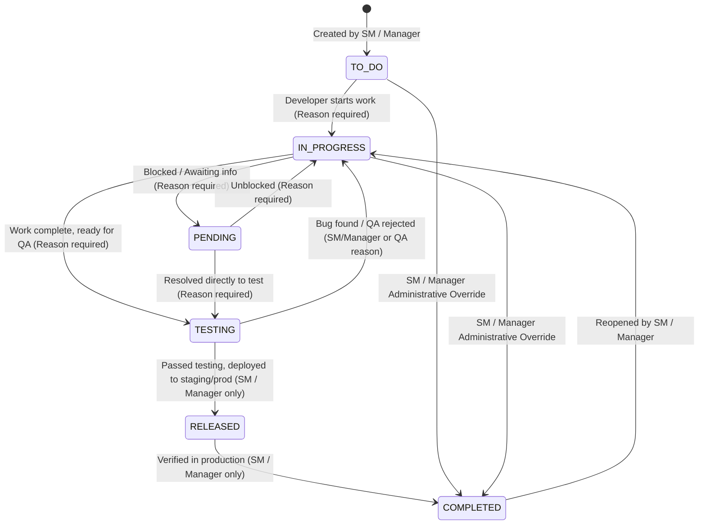

# Role-Based Access Control (RBAC) & Permissions Matrix

## 1. User Roles Definition

The system defines exactly three user roles:
1. **`MANAGER`**: System administrator, team leader, and executive controller. Holds complete visibility and ultimate decision authority over users, tasks, leaves, reports, and audit logs.
2. **`SCRUM_MASTER`**: Day-to-day operational leader and delivery coordinator. Manages task assignments, priorities, sprint/daily tracking, reviews developer requests, and inspects activity logs.
3. **`DEVELOPER`**: Core individual contributor. Works within their strictly assigned daily task scope, updates task status with mandatory explanations, uploads attachments, and submits personal requests/complaints.

---

## 2. Global Role Permission Matrix

| Module / Action | Developer | Scrum Master | Manager | Enforcement Rule / Scope Constraint |
|---|:---:|:---:|:---:|---|
| **Authentication & Profile** | | | | |
| Login with credentials | ✅ | ✅ | ✅ | Rate limited to 5 attempts per IP/username per 15m |
| Logout & invalidate session | ✅ | ✅ | ✅ | Revokes current session from database |
| Change own password | ✅ | ✅ | ✅ | Required if `must_change_password` is true |
| Reset any user's password | ❌ | ❌ | ✅ | Manager creates temporary password, marks `must_change_password` |
| Create user accounts | ❌ | ❌ | ✅ | Manager-only; assigns initial role and credentials |
| Deactivate / activate users | ❌ | ❌ | ✅ | Soft toggle via `is_active` |
| View user list | ❌ | ✅ | ✅ | Developers cannot view user directories or email lists |
| **Task Management** | | | | |
| View task list / board | Own only | All | All | Developers can only query tasks where `assigned_to_id == session.user.id` |
| View task details | Own only | All | All | Server rejects attempt by Developer to fetch other users' tasks (403 Forbidden) |
| Create new task | ❌ | ✅ | ✅ | SM and Manager define title, description, priority, assignee, date |
| Edit task title / description | ❌ | ✅ | ✅ | Developers cannot alter core task specifications |
| Change task priority | ❌* | ✅ | ✅ | Default: SM and Manager only (see section 4) |
| Assign / Reassign task | ❌ | ✅ | ✅ | Reassignment requires audit log record with previous and new assignee |
| Archive / Soft-delete task | ❌ | ❌ | ✅ | Manager-only to prevent unauthorized deletion |
| Drag & Drop task status | Own only | All | All | Triggers mandatory reason modal prior to committing drop |
| **Task Status Transitions** | | | | |
| Change status to `IN_PROGRESS` | Own only | All | All | Developer must provide mandatory status change reason |
| Change status to `PENDING` | Own only | All | All | Developer must state reason/blocker |
| Change status to `TESTING` | Own only | All | All | Developer submits implementation notes |
| Change status to `RELEASED` | ❌ | ✅ | ✅ | SM or Manager verification required |
| Change status to `COMPLETED` | ❌ | ✅ | ✅ | SM or Manager sign-off required |
| Override any status transition | ❌ | ✅ | ✅ | Allows SM/Manager to move tasks backward or forward |
| **Attachments** | | | | |
| Request presigned upload URL | Own tasks | All tasks | All tasks | Developer can only upload to tasks assigned to them |
| Upload images, videos, APKs | ✅ | ✅ | ✅ | Size limits: 50MB per file; strictly validated MIME types |
| Download task attachments | Own tasks | All tasks | All tasks | Secure download via short-lived signed GET URLs |
| Delete an attachment | ❌ | ✅ | ✅ | Preserves task documentation integrity |
| **Daily & Monthly Planning** | | | | |
| View own daily task plan | ✅ | ✅ | ✅ | Date-picker to review scheduled tasks for any given day |
| View all developers' daily plan | ❌ | ✅ | ✅ | Developer-wise grouped breakdown showing daily load |
| View monthly workload calendar | ❌ | ✅ | ✅ | High-level schedule distribution across developers |
| View unassigned developers | ❌ | ✅ | ✅ | Highlights devs who have zero tasks on selected date |
| **Requests & Leave Management** | | | | |
| Submit leave request | ✅ | ✅ | ✅ | Specifies leave type, date range, and reason |
| View own leave requests | ✅ | ✅ | ✅ | Personal status and reviewer feedback |
| View team leave requests | ❌ | ✅ | ✅ | Visible to SM and Manager; reflected on planning calendars |
| Approve / Reject leave | ❌ | ✅ | ✅ | Approver must record review remarks; updates status |
| Submit complaint | ✅ | ✅ | ✅ | Strictly confidential |
| View complaints | Own only | ✅ | ✅ | Developers CANNOT see other developers' complaints |
| Respond / Resolve complaint | ❌ | ✅ | ✅ | Records resolution remarks |
| Submit general request/issue | ✅ | ✅ | ✅ | Tickets raised to SM |
| Review general tickets | ❌ | ✅ | ✅ | SM and Manager process and resolve |
| **Activity Logging & Audit** | | | | |
| View personal activity history | Own only | All | All | Developers see their own task transitions and actions |
| View team-wide activity logs | ❌ | ✅ | ✅ | Filterable by user, date, task, request, activity type |
| Filter & export activity logs | ❌ | ✅ | ✅ | Full pagination and compound filtering |
| Modify / Delete activity logs | ❌ | ❌ | ❌ | **Strictly forbidden for all roles** (immutable database ledger) |
| **Dashboards & Analytics** | | | | |
| Developer Dashboard | ✅ | — | — | Focuses on today's tasks, priority, blockers, requests |
| Scrum Master Dashboard | — | ✅ | — | Focuses on team workload, testing queue, bottlenecks, daily progress |
| Manager Dashboard | — | — | ✅ | Focuses on executive KPIs, monthly velocity, user admin, overall health |

---

## 3. Task Status Transition Lifecycle & Business Rules

The application supports six exact statuses:
1. `TO_DO`
2. `IN_PROGRESS`
3. `PENDING`
4. `TESTING`
5. `RELEASED`
6. `COMPLETED`



### Transition Enforcement Rules
1. **Mandatory Explanation**: Every transition requires a non-empty `reason` string (minimum 5 characters). No status change can be saved without recording who changed it, the previous state, the new state, and the rationale.
2. **Developer Constraints**:
   - Developers are restricted to progressing their own active tasks (`TO_DO` -> `IN_PROGRESS` -> `PENDING` -> `TESTING`).
   - Developers **cannot** directly mark a task as `RELEASED` or `COMPLETED`. Moving to `RELEASED` and `COMPLETED` represents formal sign-off reserved for Scrum Masters and Managers.
3. **Manager & Scrum Master Overrides**:
   - Scrum Masters and Managers can override any transition, move tasks backward (e.g. `TESTING` -> `IN_PROGRESS` if a defect is found), or reassign tasks at any stage.
   - Every override still records a mandatory reason in `TaskStatusHistory` and `ActivityLog`.

---

## 4. Priority Management Policy

- **Allowed Values**: `CRITICAL`, `HIGH`, `MEDIUM`, `LOW`.
- **Default Policy**: Scrum Masters and Managers set and adjust task priorities based on sprint goals and client commitments.
- **Developer Capability**: Developers may request a priority escalation via the Reason field during a status update (e.g. moving to `PENDING` due to a critical blocker) or via a General Ticket, but cannot unilaterally alter task priority directly on the task card.

---

## 5. Server-Side Enforcement Architecture

Client-side UI conditional rendering (e.g. hiding an "Edit" button) is strictly considered a visual convenience, **never** a security boundary.

Every Server Action and Route Handler enforces security through the central helper `lib/auth/permissions.ts`:

```typescript
// Example: lib/auth/permissions.ts
export function assertPermission(role: UserRole, action: AppAction) {
  const allowedRoles = PERMISSION_RULES[action];
  if (!allowedRoles.includes(role)) {
    throw new ForbiddenError(`Role ${role} is not authorized to perform ${action}`);
  }
}

export async function assertTaskOwnershipOrAdmin(user: SessionUser, task: Task) {
  if (user.role === 'MANAGER' || user.role === 'SCRUM_MASTER') {
    return true; // Admin bypass
  }
  if (task.assigned_to_id !== user.id) {
    throw new ForbiddenError('You can only modify or access tasks assigned to you');
  }
}
```
